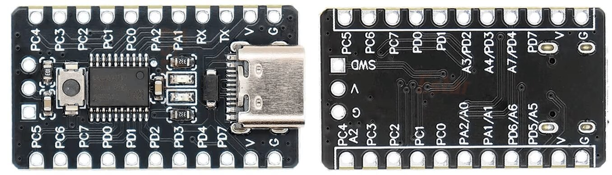
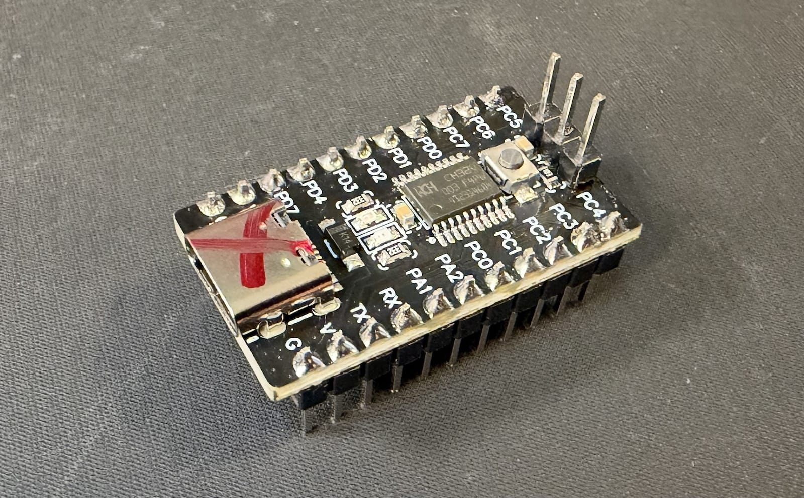
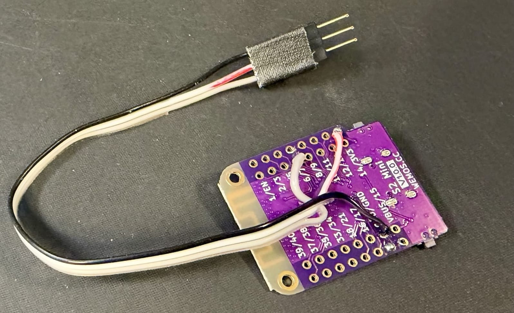
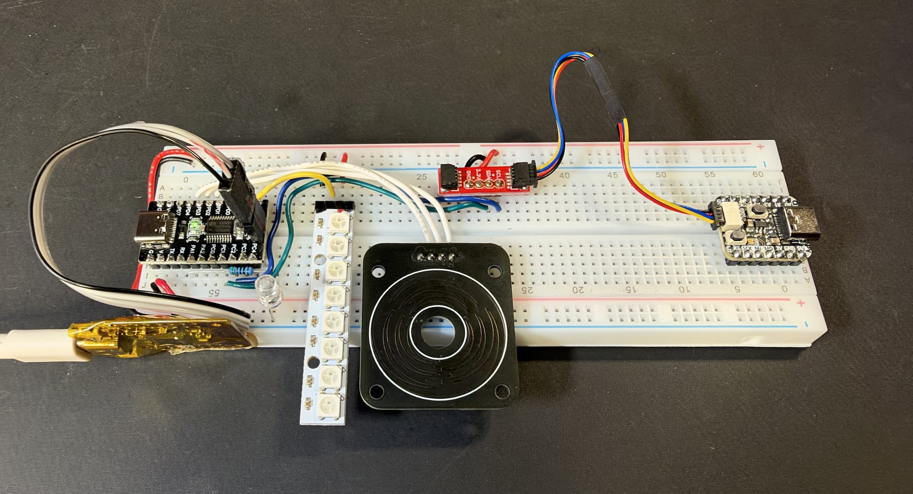

# LetsLearnCH32V003

Let's learn how to program the "10 cent" CH32V003 chip in plain C 
on [ch32fun](https://github.com/cnlohr/ch32fun), as a series of small examples.

## Assumptions

This is for those experienced with programming Arduino or C on small MCUs.
The CH32V003 has 16 kB flash and 2 kB RAM, very similar to the original Arduino, 
kind of like ATtinys today. The CH32V003 is more capable than the ATmega168 
in the original Arduino.
The device doesn't support USB and needs an external programmer.

These examples are all based on [cnlohr's ch32fun](https://github.com/cnlohr/ch32fun)
open-source minimal C-based HAL for the CH32 chips. 
Many of these examples are just reworked examples in ch32fun. 

## Hardware setup

For these examples, this [common CH32V003 dev board](https://link.amazon/B0gMU10gb)
will be used.  It contains the CH32V003F4P6 (TSSOP-20) version of the chip.
The dev boards are cheap: [5 for $10 on Amazon](https://link.amazon/B0gMU10gb).
There's very little documentation for this specific board. This
[Zephyr page](https://docs.zephyrproject.org/latest/boards/wch/ch32v003f4p6_dev_board/doc/)
is the best I've found.  
The interesting pins: button is across PC0 and VDD, LED on PD1 
(PD1 is SWIO program, not usable as GPIO, but lights while programming), 
TX / RX on PD5 / PD6 (just labeling, no circuitry). 
The USB connector is just for power, no data lines connect to the chip.



For use in a breadboard, I like to solder the header pins on, including the
3-pin pin header for the programming pins. The programming port can also 
supply power to the board, which is why I put a red 'X' on the USB-C jack.




## Hardware programmer setup

The official programmer is a "WCH Link-E". This can be had for about $5 on Aliexpress.
I didn't want to wait. Thankfully you can make a CH32 programmer from another 
dev board. I used cnlohr's ESP32-S2-based "ch32v003programmer":

Steps:
- Download https://github.com/cnlohr/esp32s2-cookbook to get "ch32v003programmer"
- Plug in an ESP32-S2 board, hold BOOT + tap RESET to put into bootloader mode
- Install ch32v003programmer on ESP32-S2 board

```sh
git clone https://github.com/cnlohr/esp32s2-cookbook
cd esp32s2-cookbook/ch32v003programmer
esptool.py -p /dev/tty.usbmodem01 -b 460800 --before=no_reset --after=no_reset \
  write_flash --flash_mode dio --flash_freq 80m --flash_size 4MB \
  0x1000 build/bootloader/bootloader.bin \
  0x10000 build/usb_sandbox.bin \
  0x8000 build/partition_table/partition-table.bin
```

Then solder three jumpers to the ESP32-S2 board: Gnd, 3V3, IO6 for SWIO.
I like the [Lolin S2Mini](https://link.amazon/B0aM3kL9F). The result looks like
the below. Use 3 F-F jumper wires to go from the programmer to the dev board.



## Breadboard setup

A number of peripherals will be attached to the CH32V003 board.  Here's how
my breadboard is set up for most of the sketches. 



Exact [pins used](#pins) described below. In the above photo, the following 
are wired up:

- CH32V003 dev board
- ESP32-S2 Mini as CH32v003progrmamer
- LED w/ resistor
- WS2812 RGB LED strip 
- 3 pad captouch touchwheel
- StemmaQT adapter hooked up to QTPy RP2040 for I2C

## Software setup
 
For details for your OS, see the
[ch32fun wiki on installation](https://github.com/cnlohr/ch32fun/wiki/Installation).
On a Mac, quickly:

```sh
brew trust riscv-software-src/riscv
brew tap riscv-software-src/riscv
brew install riscv-tools
brew install pkg-config libusb   # libusb for minichlink
```

Get this repo and build the `minichlink` programmer app:

```sh
git clone https://github.com/todbot/LetsLearnCH32V003
cd LetsLearnCH32V003
git submodule update --init
cd ch32fun/minichlink
make
```


## Examples

Each example is self-contained and builds on its own. 

| Stage | What it adds |
|---|---|
| [`10_blink`](10_blink/) | toolchain + programmer check: LED blink, printf over SWIO |
| [`12_button`](12_button/) | read the board's button (PC0), toggle the LED on each press |
| [`15_blink_input`](15_blink_input/) | 10 + keys typed in `make monitor` set the blink time |
| [`20_ws2812`](20_ws2812/) | WS2812s via SPI1+DMA on PC6, color-order check, rainbow |
| [`30_i2c_leds`](30_i2c_leds/) | I2C target (0x54), host sets LED colors via registers |
| [`40_touch_printf`](40_touch_printf/) | ADC captouch, filtering, baseline, wheel pos, printf |
| [`45_touch_ws2812`](45_touch_ws2812/) | 40 + 20: LED n lights while pad n is touched |
| [`50_i2c_touch`](50_i2c_touch/) | I2C target reporting touch status/pos/raw, INT pin |
| [`60_touchwheel`](60_touchwheel/) | complete custom-register device + Python driver |
| [`62_touchwheelsao_clone`](62_touchwheelsao_clone/) | 60 with the TouchwheelSAO register map |
| [`70_seesaw`](70_seesaw/) | Adafruit seesaw compatible (STATUS, NEOPIXEL, TOUCH) |
| [`80_oled`](80_oled/) | 128x64 SSD1306 OLED on bit-banged I2C: text, big counter, bar |
| [`90_i2c_oled`](90_i2c_oled/) | I2C target (0x55) drawing on the 80 OLED: print, rect, circle |

Each I2C example has a CircuitPython test in `host/`.

## Example Details

- **[`10_blink`](10_blink/)**
   - LED on PD6 blinks
   - `make monitor` shows `blink N`
   - if not, switch to UART printf in `funconfig.h`
- **[`12_button`](12_button/)**
   - each press toggles the LED and prints one `press` and one `release`
- **[`15_blink_input`](15_blink_input/)** 
   - keys 1-9,0 set 10-1000 ms, other keys a random time
- **[`20_ws2812`](20_ws2812/)**
   - boot shows all red, then green, then blue (checks `WSGRB` order)
   - then a rainbow chase
- **[`30_i2c_leds`](30_i2c_leds/)** (`host/code.py`)
   - scan finds 0x54
   - the 8-byte read of regs 0-7 is correct, not just the first byte
   - the out-of-range write is harmless
   - with autoshow off, LEDs hold for 2 secs, then `CMD_SHOW` turns them magenta
   - LEDs cycle colors
- **[`40_touch_printf`](40_touch_printf/)**
   - delta clearly separates touched from untouched on every pad
   - set `TOUCH_ITERS` / `TOUCH_THRESH_DEFAULT` in `touch.h` from this
   - wheel pos sweeps 1-255 with no dead zones or jumps
- **[`45_touch_ws2812`](45_touch_ws2812/)**
  - each pad lights its LED, and deltas don't change when LEDs turn on
- **[`50_i2c_touch`](50_i2c_touch/)** (`host/code.py`)
   - status, pos and deltas follow fingers
   - events latch and clear, INT (PC7) goes low and back
   - readings stay steady while the host polls hard
- **[`60_touchwheel`](60_touchwheel/)** (`host/code.py` + `touchwheelqwiic.py`)
   - no false touches or LED glitches while touching during LED updates
   - try `CONFIG` feedback bit
   - `CONFIG` bit3 lights the PD6 status LED
- **[`62_touchwheelsao_clone`](62_touchwheelsao_clone/)** (`host/code.py` + `touchwheel.py`,
  from TouchwheelSAO)
   - with no host code, the LED under your finger lights (feedback is on by default)
   - the TouchwheelSAO demo runs unchanged apart from its I2C pins
- **[`70_seesaw`](70_seesaw/)** (`host/code.py`)
   - stock `adafruit_seesaw` connects
   - `touch_read(4..7)` tracks the pads
   - NeoPixels light
- **[`80_oled`](80_oled/)**
   - OLED shows "80_oled", a counting number and a bar sweeping along the bottom
   - `make monitor` shows the refresh time once
   - if it prints `no OLED`, check wiring and that the module is at 0x3C
- **[`90_i2c_oled`](90_i2c_oled/)** (`host/code.py` + `i2c_oled.py`)
   - on boot the OLED shows "90_i2c_oled" and "addr 0x55"
   - the demo draws text, rects, a circle and a line, then bounces a ball at ~46 fps

## Compiling examples

Every example is compiled & run the same way:

```sh
cd 10_blink    # pick a sketch
make           # compiles and programs
make monitor   # to watch printfs()
```

Other things you cando in an example dir:

```sh
make build     # compile only
make flash     # compile + flash
make monitor   # view printf output (over SWIO)
make clangd    # make compile_commands.json for editors (needs bear)
```

If the programmer can't do `make monitor`, change the example's `funconfig.h`
to UART printf (TX on PD5, 115200).

The build warning from `ws2812b_dma_spi_led_driver.h` and the linker's
"RWX permissions" warning are from ch32fun and are expected (the touch
reader runs from RAM).

## Pins

    Pins are set by `#define`s at the top of each `.c` file. Defaults are for a
CH32V003F4P6 (TSSOP-20) dev board.

### Pins per stage (dev board)

| Pin | 10 | 12 | 15 | 20 | 30 | 40 | 45 | 50 | 60 | 62 | 70 | 80 | 90 |
|---|---|---|---|---|---|---|---|---|---|---|---|---|---|
| PA1 | | | | | | | | | | | | | |
| PA2 | | | | | | | | | | | | | |
| PC0 | | btn | | | | | | | | | | | |
| PC1 | | | | | SDA | | | SDA | SDA | SDA | SDA | | SDA |
| PC2 | | | | | SCL | | | SCL | SCL | SCL | SCL | | SCL |
| PC3 | | | | | | | | | | | | oSDA | oSDA |
| PC4 | | | | | | pad3 (opt) | pad3 (opt) | pad3 (opt) | pad3 (opt) | pad3 (opt) | pad3 (opt) | oSCL | oSCL |
| PC5 | | | | | | | | | | | | | |
| PC6 | | | | LEDs | LEDs | | LEDs | | LEDs | LEDs | LEDs | | |
| PC7 | | | | | | | | INT | INT | INT | | | |
| PD0 | | | | | | | | | | | | | |
| PD1 | SWIO | SWIO | SWIO | SWIO | SWIO | SWIO | SWIO | SWIO | SWIO | SWIO | SWIO | SWIO | SWIO |
| PD2 | | | | | | pad0 | pad0 | pad0 | pad0 | pad0 | pad0 | | |
| PD3 | | | | | | pad1 | pad1 | pad1 | pad1 | pad1 | pad1 | | |
| PD4 | | | | | | pad2 | pad2 | pad2 | pad2 | pad2 | pad2 | | |
| PD5 | | | | | | | | | | | | | |
| PD6 | LED | LED | LED | | | | | LED | LED | LED | | | |
| PD7 | | | | | | | | | | | | | |

What each pin does:
- **SWIO (PD1):** programming, and debug printf (`make monitor`), in every
  stage. Only GND, 3V3 and SWIO go to the programmer.
- **LED (PD6, stages 10-15, 50-62):** push-pull output. Wire it through 330 ohm to an
  LED and then GND. In 50 and 60 it's the status LED, set by `CONFIG` bit3. In 62 it's
  set by `LED_STATUS`.
- **btn (PC0, stage 12):** the dev board's button connects PC0 to VDD, so it's read as an input
  with pull-down and a press reads 1. In every stage, never drive PC0 low: a press would short
  VDD to it.
- **SDA/SCL (PC1/PC2):** I2C1, alternate-function open-drain. Needs pull-ups somewhere on the
  bus, most hosts don't have them. These pins are 5V tolerant.
- **LEDs (PC6):** WS2812 data. It is SPI1 MOSI, fixed by the driver. Use a
  74AHCT1G125 buffer for 5V LEDs.
- **pad0-3:** captouch on ADC channels. PC4=A2, PD2=A3, PD3=A4, PD4=A7.
  - 40, 50, 60 and 62 default to a 3-pad wheel on PD2/PD3/PD4. PC4 is an optional 4th pad.
  - The 4-pad map is commented out next to it in their `.c` files.
- **INT (PC7):** open-drain output, active low. It's low while
  `TOUCH_EVENTS != 0`.
- **oSDA/oSCL (PC3/PC4):** bit-banged I2C to the OLED, kept off I2C1 so I2C1 can be a
  peripheral. It drives high push-pull, so the OLED must be the only device on these pins.

Other pins:
- **PD5:** UART TX, only if `funconfig.h` is switched to UART printf
- **PD7:** NRST by default (option bytes), unused
- **PA1/PA2:** free. These boards have no crystal, the V003 runs on its internal RC
- **PD1:** the dev board's LED is on it, wired to VDD, so it lights while SWIO is low
- **PC3 (except 80, 90), PC5, PD0:** free

### Examples 60 and 62 on the dev board (CH32V003F4P6, TSSOP-20)

```
                        +----\/----+
     pad2  A7  PD4   1 -|          |- 20  PD3  A4  pad1
   (UART TX)   PD5   2 -|          |- 19  PD2  A3  pad0
 (status LED)  PD6   3 -|          |- 18  PD1  SWIO -> programmer
       NRST    PD7   4 -|          |- 17  PC7  INT out (active low)
               PA1   5 -|          |- 16  PC6  WS2812 data (SPI1 MOSI)
               PA2   6 -|          |- 15  PC5
        GND    VSS   7 -|          |- 14  PC4  A2  pad3 (optional)
               PD0   8 -|          |- 13  PC3
       3.3V    VDD   9 -|          |- 12  PC2  I2C SCL
    (button)   PC0  10 -|          |- 11  PC1  I2C SDA
                        +----------+
```

### Pin usage notes

- Touch pins must have an ADC channel. A0-A7 are channel numbers, not
  port A: A0=PA2 A1=PA1 A2=PC4 A3=PD2 A4=PD3 A5=PD5 A6=PD6 A7=PD4
- `TOUCH_PINS` entries are `{port, pin, adc_chan}`, so PD4 is `{GPIOD,4,7}`
- Other ADC pins: PA2 (A0), PA1 (A1), PD5 (A5), PD6 (A6). Using PD5 for touch means giving up
  the UART printf fallback.
- `NUM_PADS` (3 or 4) and `TOUCH_WHEEL` (wheel vs buttons) are compile-time

### 3.3V and 5V hosts

Only the FT pins (PC1, PC2, PC5, PC6) are 5V tolerant. They take up to 5.5V even when VDD is 3.3V
(datasheet Table 3-1). All other pins are limited to VDD+0.3V, and that includes INT (PC7) and
the touch pins.

- **I2C works with 3.3V and 5V hosts.** SDA/SCL are open-drain on FT pins, so the CH32 only pulls
  low and the high level is set by the pull-ups.
  - At VDD = 3.3V the CH32 reads above ~1.7V as high and below ~0.76V as low (Table 3-16).
  - A 5V ATmega328P needs at least 3.5V for a high (0.7 x VCC). It gets that when the pull-ups
    go to 5V.
- **Power.** The board has no regulator, so connector V+ is VDD.
  - The V003 runs on 2.7-5.5V, so 5V from an Arduino is fine, and it gives the WS2812 better data
    levels.
  - An Uno's 3.3V pin (~50mA) is too weak for the LEDs.
- **Don't hot-plug the board unpowered onto a live 5V bus.** The datasheet doesn't say whether
  the FT rating holds with VDD off.
- **There are no I2C pull-ups on the board yet.**
  - Arduino `Wire` enables weak internal ones (~20-50k), which are OK at 100kHz on short wires.
  - CircuitPython needs pull-ups somewhere on the bus.
  - Consider 4.7k-10k pull-ups to VDD with a cut-jumper.

## Captouch (stages 40-70)

The V003 has no touch peripheral. `touch.h` uses ch32fun's ADC method:
`ReadTouchPinSafe()` from `extralibs/ch32v00x_touch.h`, the same one as
`examples/cap_touch_adc`. It does not use the EXTI/timer method from
`examples/cap_touch_exti`.

How a read works:

1. Between reads the pin is driven high, which charges the pad.
2. Start an ADC conversion, then switch the pin to input with the internal
   pull-down on (45k typ).
3. The ADC samples partway down the RC discharge curve. More capacitance (a
   finger) means a slower fall, so a higher reading.
4. Repeat 3x per iteration with slightly different delays to average out ADC
   nonlinearity. `TOUCH_ITERS` (16) iterations are summed into one raw value
   (max 16*3*1023, fits in u16).

What that means:

- Pads must be on pins with an ADC channel (A0-A7, see Pins), so max 8 pads
- No external resistors needed, the internal pull-down does the discharging
- Much finer resolution than EXTI timing (ch32fun says EXTI is only good for
  "down" detection)
- The "Safe" variant keeps IRQs off only briefly around each pin change, so
  I2C and the WS2812 DMA keep running
- Needs `FUNCONF_SYSTICK_USE_HCLK 1`, since the read uses `SysTick->CNT` to
  line up its timing with the CPU clock
- The read code runs from RAM for stable timing, which is why the linker
  warns about RWX

Wiring pads:

- Wire each pad straight to its ADC pin, with short wires. Wire capacitance adds to the baseline,
  and a finger near the wire reads as a touch.
- Pads need no ground connection. The finger couples to the board's ground through your body.
- External 1M pull-downs (like on synth/touchpads boards) are fine but not needed. They're about
  20x weaker than the internal 45k, so they only shift the baseline a few percent.
  - With the resistors' common end tied to GND, they're 1M pull-downs.
  - With the common end floating, all pads are linked through 2M. Idle pads sit driven high, so
    the common floats near VDD. That's also a small, steady shift.

Processing in `touch_update()`, per pad:

- **Filter:** IIR, `filt += (raw - filt) / 4`
- **Baseline:** the average of 16 reads at boot, redone `TOUCH_RECAL_MS` (500ms) later as the
  pads settle. While untouched it follows drops by 1/8 of the gap per update, so a noise spike
  can't drag it down, and creeps up 1 count every `TOUCH_DRIFT_RATE` updates. It freezes while
  touched.
- **Touch:** `filt - baseline > thresh`, released below `thresh * 3/4`
  (hysteresis), with `TOUCH_DEBOUNCE` samples in a row needed to change
- **Wheel position:** take the strongest touched pad, then interpolate
  toward its stronger neighbor. Integer math only (no FPU), no dead zones.

## Register map (custom mode, stages 30, 50, 60)

1-byte register address, auto-incrementing. u16 values are little-endian.

| Addr | R/W | Name | Notes |
|---|---|---|---|
| 0x00 | R | `WHO_AM_I` | 0xC3 |
| 0x01 | R | `FW_VERSION` | stage number |
| 0x02 | R | `TOUCH_STATUS` | bit n = pad n touched |
| 0x03 | R/W | `TOUCH_EVENTS` | latched presses, write 1s to clear |
| 0x04 | R/W | `CONFIG` | bit0 INT en, bit1 autoshow, bit2 feedback, bit3 status LED |
| 0x05 | R/W | `BRIGHTNESS` | 0-255 global LED scale |
| 0x06 | W | `COMMAND` | 0x01 show, 0x02 recalibrate, 0xA5 reset |
| 0x07 | R | `WHEEL_POS` | 0 = no touch, 1-255 around wheel |
| 0x08-0x0F | R | `TOUCH_RAW[4]` | u16 filtered reading |
| 0x10-0x17 | R | `TOUCH_BASELINE[4]` | u16 |
| 0x18-0x1F | R/W | `TOUCH_THRESH[4]` | u16 delta above baseline |
| 0x20-0x37 | R/W | `LED[8][3]` | R,G,B per LED |

- autoshow: LEDs update after any write that reaches 0x20+
- feedback: firmware lights the LED under your finger (overwrites LED regs)
- status LED: lights the LED on PD6 (50 and 60)
- INT asserts while `TOUCH_EVENTS != 0` and `CONFIG` bit0 is set

## TouchwheelSAO clone map (stage 62)

62 is 60 with registers 0x00-0x1B laid out like the
[TouchwheelSAO](https://github.com/todbot/TouchwheelSAO), so the SAO's own host driver
(`host/touchwheel.py`) works with it. 60's extras sit from 0x1C up.

| Addr | R/W | Name | Notes |
|---|---|---|---|
| 0x00 | R | `POSITION` | 0 = no touch, 1-255 around the wheel |
| 0x01 | R | `TOUCHES` | bit n = pad n touched |
| 0x02-0x07 | R | `RAW0-2` | u16 filtered reading, pads 0-2 |
| 0x08-0x0D | R/W | `THRESH0-2` | u16 delta above baseline, pads 0-2 |
| 0x0E | R/W | `LED_STATUS` | non-zero lights the LED on PD6 |
| 0x0F-0x11 | R/W | `LED_RGB` | R,G,B: writing a channel sets it on all LEDs |
| 0x12-0x1A | R/W | `LED0-2` | R,G,B of LEDs 0-2, same data as the first 9 bytes of `LEDS` |
| 0x1B | R | `VERSION` | 62 |
| 0x1C | R | `WHO_AM_I` | 0xC3 |
| 0x1D | R/W | `EVENTS` | latched presses, write 1s to clear |
| 0x1E | R/W | `CONFIG` | bit0 INT en, bit1 autoshow, bit2 feedback |
| 0x1F | R/W | `BRIGHTNESS` | 0-255 global LED scale |
| 0x20 | W | `COMMAND` | 0x01 show, 0x02 recalibrate, 0xA5 reset |
| 0x22-0x23 | R | `RAW3` | u16, optional pad 3 |
| 0x24-0x25 | R/W | `THRESH3` | u16, optional pad 3 |
| 0x28-0x2F | R | `BASELINE0-3` | u16 |
| 0x40-0x57 | R/W | `LEDS` | R,G,B for all 8 LEDs |

- feedback is on by default, like the SAO
- Differences from the TouchwheelSAO:
  - `TOUCHES` bits are in pad order. The SAO puts pad 0 in bit 2.
  - `THRESH` is a delta above baseline and writable. The SAO's is an absolute count.
  - Multi-byte reads work, and LEDs don't fade out after a touch.

## OLED map (stage 90)

Default address 0x55. 1-byte register address, auto-incrementing.

| Addr | R/W | Name | Notes |
|---|---|---|---|
| 0x00 | R | `WHO_AM_I` | 0xC4 |
| 0x01 | R | `FW_VERSION` | 90 |
| 0x02 | R | `STATUS` | bit0 busy |
| 0x04 | R/W | `CONFIG` | bit1 autoshow |
| 0x05 | R/W | `CONTRAST` | 0-255, default 0x8F |
| 0x06 | W | `COMMAND` | command byte, see below |
| 0x07-0x2E | W | `ARGS[40]` | command args |

Send a command as one write, `[0x06, cmd, args...]`. Wait until `STATUS` bit0 is clear
before the next one: a command sent while busy is dropped. Draw commands only change the
framebuffer. `show` sends it to the OLED (18 ms), or set autoshow to show after every command.
Colors are 0 or 1.

| Cmd | Name | Args |
|---|---|---|
| 0x01 | show | |
| 0x10 | clear | color |
| 0x11 | pixel | x, y, color |
| 0x12 | line | x0, y0, x1, y1, color |
| 0x13 | rect | x, y, w, h, color |
| 0x14 | fill_rect | x, y, w, h, color |
| 0x15 | circle | x, y, r, color |
| 0x16 | fill_circle | x, y, r, color |
| 0x17 | print | x, y, size (1-8), color, text (up to 36 chars) |
| 0x18 | invert | on (0 or 1), takes effect without show |
| 0xA5 | reset | |

## Seesaw mode (stage 70)

Default address 0x49. It works with stock CircuitPython `adafruit_seesaw`:

```py
ss = Seesaw(board.STEMMA_I2C(), 0x49)
ss.touch_read(4)                     # pins 4-7 = pads 0-3
pixels = NeoPixel(ss, 0, 8)          # pin number ignored
```

The lib only accepts certain chip IDs, and Crickit's pinmap allows
`touch_read()`. So the firmware reports HW_ID 0x55 (SAMD09) and PID 9999
(Crickit). Only STATUS, NEOPIXEL (RGB only) and TOUCH are implemented.

## Notes

- **No multiply/divide hardware** (RV32EC): `*` and `/` are libgcc calls. That
  is fine at these rates, but keep math out of ISRs where you can.
- **ISRs:** the I2C write callback and the WS2812 callback run in interrupts.
  Keep them short, and never printf there.
- **printf cost:** debug printf hands the programmer 7 bytes at a time over SWIO and waits
  for each chunk to be read. With `minichlink -T` running, every line slows the loop, so
  print on changes, not every pass. With nothing reading, the first printf times out
  (~120ms), then printf skips output without waiting. The I2C stages don't printf.
- **Changing host I2C speed:** after the host switched from 100kHz to 400kHz, the CH32 didn't
  respond until it was reset. Reset the CH32 after changing bus speed, or if the host suddenly
  gets timeouts or no ACK. The cause isn't known yet.
- **Touch vs. LEDs:** touch is only sampled when no LED DMA transfer is
  running.
- **`DMALEDS 32`** is set before including ch32fun's WS2812 driver. With its default of 16,
  8 LEDs show only the first 6 (7-9 and 15-17 LEDs lose some too). With 32, 15-21 LEDs
  lose some instead, so recheck if you change `NUM_LEDS`.
- **TOUCH_THRESH_DEFAULT** (500, in `touch.h`) comes from buttons4x0 pads on the dev board:
  touches read ~3000-3600 above baseline, idle noise peaks around ±230 raw. Retune with
  `40_touch_printf` for other pads or overlays.


## Links

- https://www.wch-ic.com/products/CH32V003.html - CH32V003 homepage
- https://cw2.github.io/ch32v003/ - list of dev boards
- https://github.com/wagiminator/Development-Boards/tree/main/CH32V003F4P6_DevBoard - not the board we're using, but similar
- https://github.com/lemio/esp-wasm/tree/main/toolchain/examples/funprog/examples/CH32V003_Programmer - ESP32-S3 programmer in Arduino
- https://lemio.github.io/esp-wasm/ - browser-based tool w/ CH32 examples
- https://github.com/eric15342335/inspirematrix-buttons - example projects
- https://siliconjunction.top/2026/01/30/getting-started-with-the-ch32v003/ - getting started

